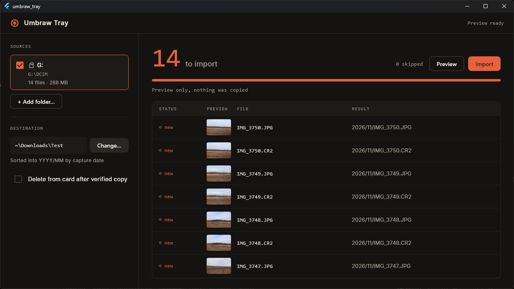

# Umbraw Tray

**Get photos off the card and into the dark, safely.**

Umbraw Tray is a desktop app for Windows, macOS and Linux that copies photos
and video from a camera card into a library folder sorted by year and month.
It checks every copy before it counts, remembers what it has already
imported, and never overwrites anything.



```
Pictures/EOS T7/
├── 2025/
│   ├── 06/
│   │   ├── IMG_0401.JPG
│   │   └── IMG_0402.CR2
│   └── 07/
│       ├── IMG_0412.CR2
│       └── MVI_0410.MP4
└── _ingest-ledger.json
```

---

## Features

- **Finds your card automatically.** Insert a card and it appears in the
  sidebar within a couple of seconds, with its file count and size. Anything
  mounted with a `DCIM` folder at its root counts as a card.
- **Sorts by when you took the shot.** Files are dated from the EXIF capture
  time, not the file timestamp (which changes when files are copied). Videos
  and anything without EXIF fall back to the file timestamp, and the app tells
  you when it did.
- **Verifies every copy.** Each file is copied to a temporary `.part` file,
  checked against the original by SHA-1, and only then given its real name.
  An interrupted import never leaves a half-copied file that looks finished.
- **Never imports the same photo twice.** A ledger in your library records
  every file by its contents, so re-inserting a card only copies what's new.
- **Never overwrites.** A different photo with a name that's already taken is
  saved as `IMG_0001_1.JPG`.
- **Shows a preview of each file.** JPEGs and Canon raw files (`.CR2`) show the
  small preview the camera stores inside them, rotated the right way up.
- **Preview before you commit.** **Preview** lists where every file would go
  without copying anything.
- **Optionally clears the card.** Turn on *Delete from card after verified
  copy* and each original is removed only once its copy has been verified.

Supported files: `.jpg` `.jpeg` `.cr2` `.mp4` `.mov` `.avi` `.wav`

---

## Getting started

### 1. Install Flutter

Follow the official guide at
[docs.flutter.dev/get-started/install](https://docs.flutter.dev/get-started/install),
choosing your operating system and the **desktop** option.

On a Mac with Homebrew, this is one command:

```sh
brew install --cask flutter
```

### 2. Install your platform's build tools

| Platform | What to install |
| --- | --- |
| **macOS** | Xcode from the App Store, then `sudo xcodebuild -license accept` and `brew install cocoapods` |
| **Windows** | Visual Studio Community (not VS Code) with the **Desktop development with C++** workload |
| **Linux** | `sudo apt install clang cmake ninja-build pkg-config libgtk-3-dev` |

Check that everything is in place:

```sh
flutter doctor
```

Fix anything marked ✗ under your desktop platform. Android and Chrome
warnings don't matter for this app.

### 3. Set up the project (first time only)

This folder holds the app's code but not the per-platform project files,
which Flutter generates. Open a terminal in this folder and run:

```sh
flutter create --platforms=windows,macos,linux --project-name umbraw_tray --org com.umbraw .
flutter pub get
```

The `.` at the end means "this folder". `flutter create` only adds files that
are missing, so it leaves the app's code, tests, fonts and macOS settings
alone.

**Optional: name the window.** Flutter titles the window `umbraw_tray`. To
show "Umbraw Tray" instead, edit the following file for your platform:

- **Windows:** `windows/runner/main.cpp`: change `L"umbraw_tray"` to `L"Umbraw Tray"`.
- **macOS:** `macos/Runner/Configs/AppInfo.xcconfig`: set `PRODUCT_NAME = Umbraw Tray`.
- **Linux:** `linux/runner/my_application.cc`: change both `"umbraw_tray"` titles to `"Umbraw Tray"`.

### 4. Run it

```sh
flutter run -d macos      # or: -d windows, -d linux
```

The first build takes a few minutes; later ones are much quicker.

### 5. Build a standalone app (optional)

```sh
flutter build macos       # or: windows, linux
```

| Platform | Where the app ends up |
| --- | --- |
| macOS | `build/macos/Build/Products/Release/` |
| Windows | `build/windows/x64/runner/Release/` |
| Linux | `build/linux/x64/release/bundle/` |

Flutter can't cross-compile desktop apps, so build each platform on a machine
running that platform.

---

## Using Umbraw Tray

1. **Insert your card** in a card reader. It shows up under **Sources** with
   its file count and size. Untick any source you don't want, or use
   **Add folder…** to import from any folder instead.
2. **Choose a destination** under **Destination**. This is your library's top
   folder; the app creates the `YYYY/MM` folders inside it. It remembers the
   folder next time.
3. **Click Preview** to see where everything would go, or **Import** to copy.
4. Watch the table: each file shows a preview, its status (**copied**,
   **skipped** or **failed**) and where it went. **Stop** halts right away:
   a file that was mid-copy is discarded, and everything copied before it
   stays imported.

### The ledger

`_ingest-ledger.json` lives in your library folder and lists every imported
file by a fingerprint of its contents (SHA-1) and where it was saved. On each
import the app fingerprints every file on the card and skips any it has seen,
so camera file numbers wrapping around, or swapping cards, never causes
duplicates.

Good to know:

- **Each library has its own ledger.** Importing into two different folders
  keeps two separate records.
- **Moving or renaming photos inside the library** makes the ledger lose
  track of them. If they're still on the card, the next import copies them
  again.
- **Deleting a photo from the library** works the same way: it comes back if
  it's still on the card. Use *Delete from card after verified copy* if you
  don't want that.
- **Re-checking a card still reads every file**, since that's how the
  fingerprints are made. Nothing is copied twice, but a card full of video
  takes a while to check.

The ledger format is shared with the `eos_ingest.py` script and the earlier
EOS Ingest app, so a library made with either carries straight over.

---

## Troubleshooting

**My card isn't showing up.**
- Use a card reader. Plugged in over USB, a camera appears as a media (MTP/PTP)
  device rather than a drive, and the app can't see it. **Add folder…** works
  as a fallback.
- **macOS:** the first time, macOS asks whether Umbraw Tray may access removable
  volumes. If you declined, re-enable it in *System Settings → Privacy &
  Security → Files and Folders*.
- **Linux:** the card must be mounted. Open it once in your file manager, and
  it should appear within a couple of seconds.
- **Windows:** only drives Windows reports as removable are detected. Some
  built-in laptop card slots report as fixed drives; use **Add folder…** for
  those.

**A backup drive shows up as a card.**
On macOS and Linux, any mounted drive with a `DCIM` folder at its root counts.
Untick it in the sidebar.

**"Can't find this folder. Is its drive connected?"**
Your destination is on a drive that isn't plugged in, or the folder was moved.
Reconnect it or choose a new destination.

**Some files say "date from file timestamp".**
Those files had no EXIF capture date (usually videos), so they were filed by
the file's modification time instead. Check they landed in the month you
expect.

**`flutter create` or `flutter run` prints errors.**
Run `flutter doctor` first and fix anything it flags for your platform. If
the errors come from the app's own code, they'll point at a file in `lib/`.

---

## Running the tests

```sh
flutter test
```

The tests cover EXIF date and preview reading, sorting into `YYYY/MM`,
skipping already-imported files, renaming on name clashes, deleting from the
card, and reading older ledgers.

---

## Project layout

```
lib/
├── main.dart               The window: sidebar, counter, progress and table
└── src/
    ├── cards.dart          Finds mounted cards on each platform
    ├── windows_drives.dart Asks Windows which drives are removable
    ├── exif.dart           Reads capture dates and embedded previews
    ├── ingest.dart         Scans, copies, verifies and keeps the ledger
    ├── settings.dart       Remembers the destination and options
    └── theme.dart          Colors, fonts and button styles
test/                       Unit and widget tests
assets/fonts/               Inter, the interface font
macos/Runner/*.entitlements Turns off the App Sandbox so cards are visible
```

Settings are saved in `%APPDATA%\Umbraw Tray` (Windows),
`~/Library/Application Support/Umbraw Tray` (macOS) or `~/.config/umbraw-tray`
(Linux).

---

## Credits

The interface font is [Inter](https://rsms.me/inter/) by Rasmus Andersson,
used under the SIL Open Font License (see `assets/fonts/Inter-LICENSE.txt`).
